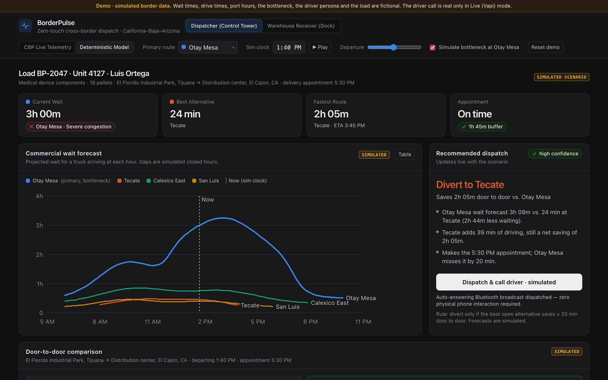
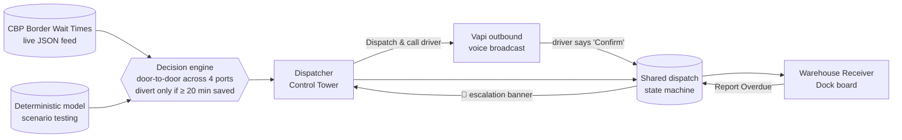
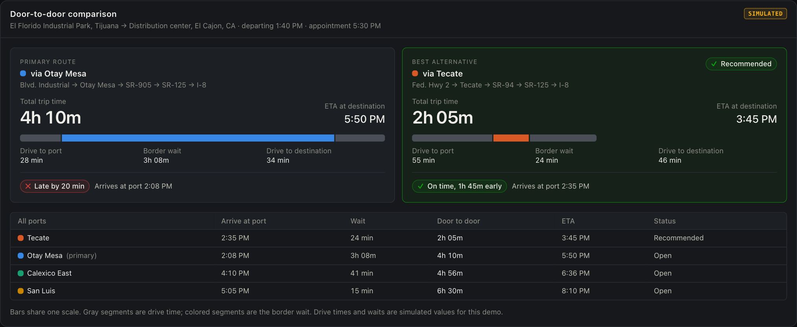
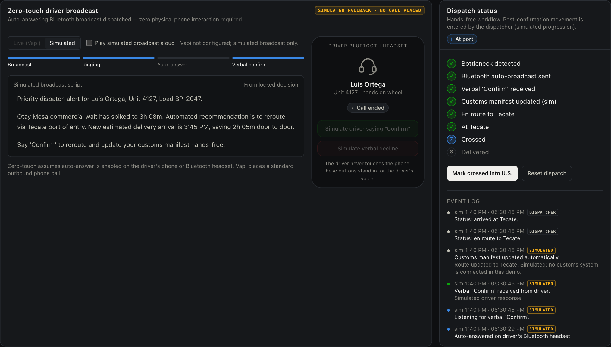
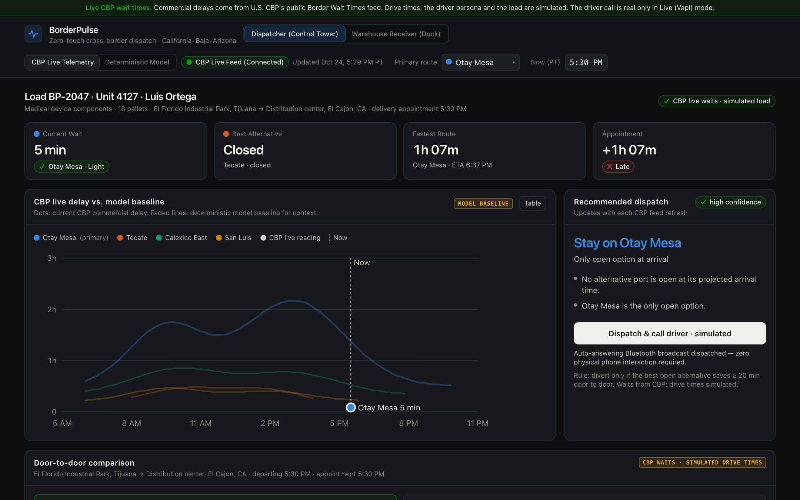
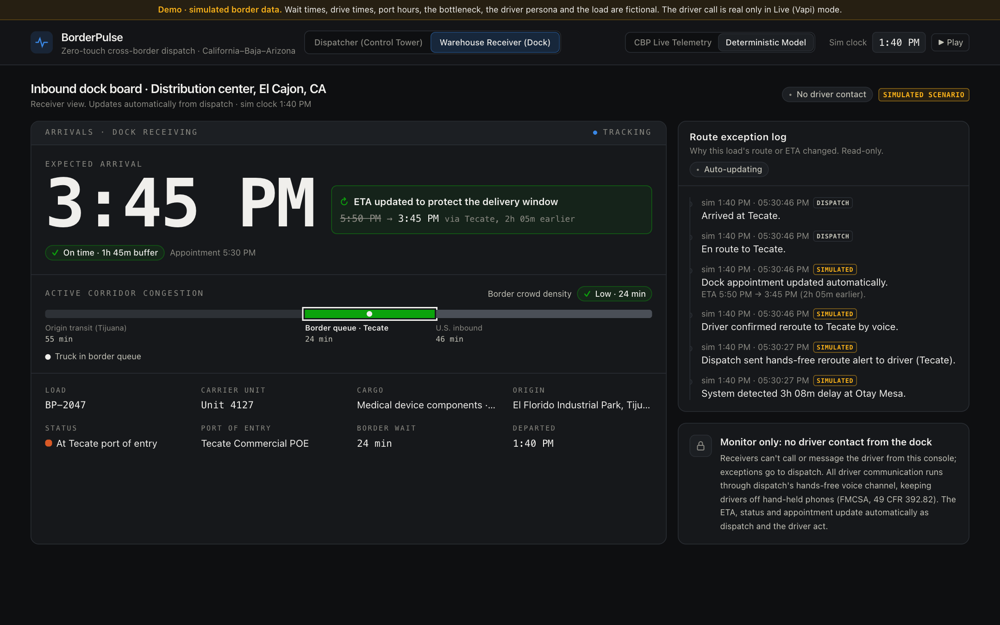
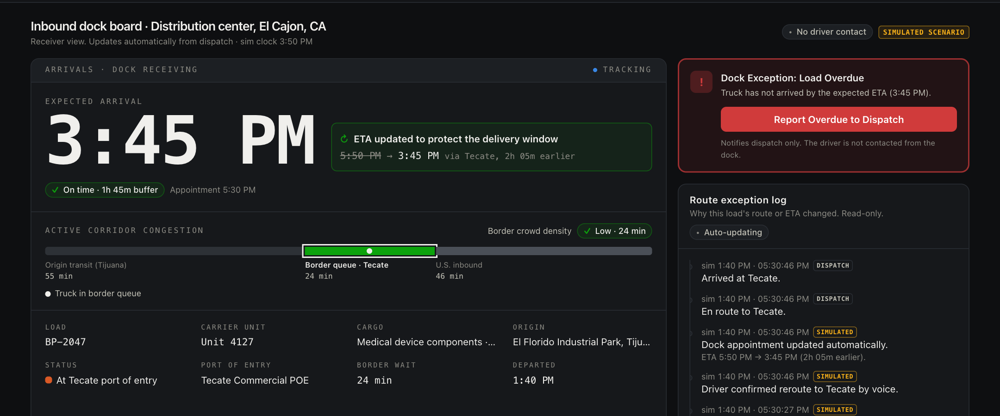
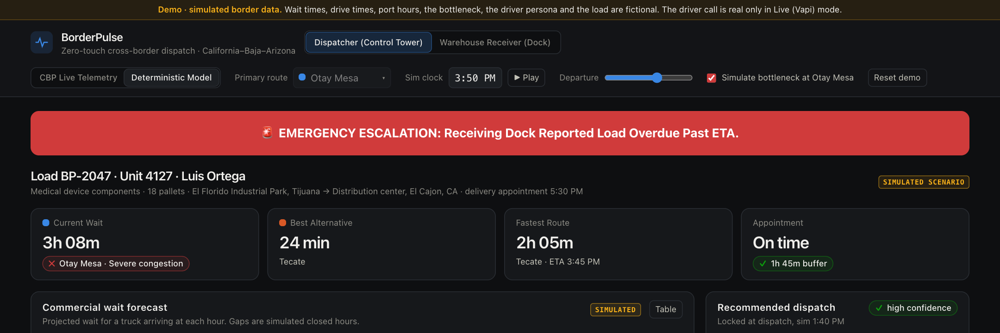
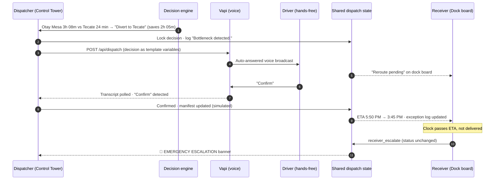

# BorderPulse

**One shared view of a cross-border truck, for the dispatcher who routes it and the warehouse that receives it.**

BorderPulse watches commercial wait times at four California–Baja California and Arizona–Sonora ports of entry. It reroutes
a load when another port is meaningfully faster and tells the driver hands-free by voice. The dispatcher's Control Tower
and the receiving dock's arrival board both run off the same live dispatch state.

Built for **cOmpiled-16 · Track 1 (Dispatch)**.



> **In 30 seconds**
> - **Problem:** dispatchers, drivers and receivers coordinate by phone calls and guesswork. Federal and industry research
>   ties the resulting detention to billions in losses and higher crash risk. Border queues make it worse: Otay Mesa
>   commercial waits have hit 4–8 hours.
> - **Solution:** a decision engine that compares door-to-door time across four ports. It sends a hands-free voice
>   broadcast the driver confirms by saying "Confirm", and gives the receiver an arrival board that updates itself,
>   with a one-click escalation path that never involves the driver's phone.
> - **Honesty note:** the border data can come from **real CBP feeds** or a **deterministic simulation**, and the UI always
>   says which. The driver, the load and the customs/dock-system updates are simulated. See
>   [What's real vs. simulated](#whats-real-vs-simulated).

---

## Contents

1. [The problem, with evidence](#1-the-problem-with-evidence)
2. [The solution: BorderPulse](#2-the-solution-borderpulse)
3. [Core platform features](#3-core-platform-features)
4. [Product tour: dispatcher and receiver](#4-product-tour)
5. [Real-world use cases](#5-real-world-use-cases)
6. [How it works](#6-how-it-works)
7. [What's real vs. simulated](#whats-real-vs-simulated)
8. [Run it](#8-run-it)
9. [Limitations and roadmap](#9-limitations-and-roadmap)
10. [Sources](#sources)

---

## 1. The problem, with evidence

A cross-border load has at least three parties: the **dispatcher** who plans the route, the **driver** who is legally
barred from using a hand-held phone, and the **receiver** whose dock schedule depends on an accurate ETA. Today they
mostly coordinate by phone. When something changes, such as a border queue spiking, the information reaches each party
late or not at all.

### 1.1 Poor dispatcher–receiver coordination shows up as detention, at enormous cost

| Finding | Source |
|---|---|
| Drivers were detained at **39.3% of all stops** in 2023, rising to **56.2%** for refrigerated loads. | ATRI, Sept 2024 [^atri] |
| Detention cost the industry **$3.6 billion in direct expenses and $11.5 billion in lost productivity** in 2023, more than **135 million hours** lost in for-hire trucking. | ATRI, Sept 2024 [^atri] [^ttnews] |
| **94.5%** of fleets charge detention fees, but fewer than **half** of those invoices are paid. | ATRI, Sept 2024 [^atri] |
| Detention at shipper and receiver facilities costs for-hire truckload drivers **$1.1–$1.3 billion a year** in lost earnings. | U.S. DOT Office of Inspector General, ST2018019, Jan 2018 [^oig] |
| Only **1 in 5 shippers** agree their logistics providers give them sufficient shipment visibility. | FreightWaves × Tive survey [^tive] |

### 1.2 The coordination gap is a safety problem, not just a cost problem

| Finding | Source |
|---|---|
| A **15-minute increase** in average dwell time at a facility was estimated to raise expected crash rates by **6.2%**. Applied to 2013 crash counts, that is roughly 6,500 crashes. | DOT OIG, Jan 2018 [^oig] [^ccj] |
| Each **5-point increase** in the share of stops with detention raised expected crash rates by **4.7%**. | DOT OIG, Jan 2018 [^oig] |
| Detained trucks drove **14.6% faster** on average than trucks that were not detained, as drivers tried to make up lost time. | ATRI GPS analysis, Sept 2024 [^atri] |

> The OIG notes its estimates rely on limited 2013 data, and that industry-wide detention data does not exist yet. The
> direction of the effect is consistent across both studies.

### 1.3 The border makes ETAs volatile, and nobody downstream hears about it in time

| Finding | Source |
|---|---|
| Trucks at **Otay Mesa** waited **4 to 4.5 hours** on the Mexican side, with lines **one to two miles long**, as inspections slowed (Aug 2019). | FreightWaves, Aug 15, 2019 [^fw2019] |
| Cargo trucks waited **up to 8 hours** at Otay Mesa after a customs-requirement change; normal waits are 1–3 hours (Sept 2020). | FreightWaves, Sept 16, 2020 [^fw2020] |
| Border delays at the California–Baja California ports cost an estimated **$3.4 billion in economic output and 88,000 jobs** (2016 data). | SANDAG, Caltrans & ICTC, Feb 2021 [^sandag] [^kpbs] |
| Nine days of enhanced truck inspections at Texas ports (April 2022) cost an estimated **$4.2 billion** in Texas gross product, about **$9 billion** nationally. | The Perryman Group, via Transport Topics [^perryman] |

A sudden border bottleneck changes the driver's ETA by hours. The receiver usually finds out when the truck doesn't
show up.

### 1.4 "Just call the driver" is the wrong fix

| Finding | Source |
|---|---|
| Truck drivers who were **texting** had **23.2× higher odds** of a safety-critical event; **interacting with a dispatching device** raised the odds **9.9×**. | FMCSA, *Driver Distraction in Commercial Vehicle Operations*, Oct 2009 [^fmcsa-study] |
| Federal rules bar CMV drivers from using hand-held mobile phones while driving. "Use" includes holding the phone for a call or dialing/answering by **pressing more than a single button**. | 49 CFR 392.82 [^cfr39282]; definition in 49 CFR 390.5 [^cfr3905] |

The usual workarounds make things worse: receivers calling dispatch for updates, dispatch calling or texting the
driver, and the driver checking a dispatch screen. **The problem is a shared-visibility problem, and the driver has to be
reached hands-free.**

---

## 2. The solution: BorderPulse

BorderPulse puts the dispatcher and the receiver on **one platform, reading one dispatch state**. The driver is reached
by voice only.



**For the dispatcher:** live congestion across four ports, a reroute recommendation with the math shown, and one button
that briefs the driver hands-free and records the confirmation.

**For the receiver:** an arrival board with a large ETA that updates itself, a corridor bar showing where the truck is
and how crowded the border is, and an exception log explaining *why* the ETA changed. No phone calls needed. If the truck
is overdue, one click escalates to dispatch, never to the driver.

**For the driver:** no screen. An auto-answered voice broadcast; they say "Confirm" and keep both hands on the wheel.

---

## 3. Core platform features

**Multi-port algorithmic decision engine.** Calculates door-to-door transit time for each crossing as
*origin transit + border queue + inbound delivery*, across **Otay Mesa, Tecate, Calexico East and San Luis**. Each
primary route has its own lane (origin, destination, appointment) with legs to all four ports.

**Automated reroute matrix.** Enforces a strict **20-minute divert threshold**. The engine recommends a reroute only if
the best *open* alternative saves at least 20 minutes door to door. It also checks that the port will be open when the
truck arrives, and flags a reroute that arrives close to closing time. The reasons and a confidence level are shown with
every recommendation.

**Dual data ingestion (live and simulated).** A header toggle switches between:
- **CBP Live Telemetry:** real commercial-lane delays from U.S. Customs and Border Protection's public Border Wait
  Times JSON feed, refreshed every 60 s and cached server-side. Closed lanes and "Update Pending" ports count as
  unavailable, and port clocks are normalized to Pacific time.
- **Deterministic Model:** reproducible wait curves, a departure-time slider and a bottleneck toggle for stress-testing.
  If CBP is unreachable, the app falls back to the model and labels it.

**Zero-touch driver voice execution.** Designed around the FMCSA hand-held phone rule (49 CFR 392.82). Dispatch triggers
an outbound voice broadcast through **Vapi** to the driver's phone or headset. The driver says **"Confirm"**, the system
detects it in the call transcript, and the load status updates. The customs-manifest step is **simulated** in this demo.
Zero-touch assumes auto-answer is enabled on the driver's phone or headset. If the live call fails, a clearly labeled
simulated broadcast takes over.

**Synchronized dual-profile dashboard.** A **Dispatcher Control Tower** (routing, telemetry, broadcast) and a
**Warehouse Receiver Dock** (monitor-only arrival board, no driver contact). Both read the **same dispatch state
machine**, so reroutes, ETA changes and escalations appear in both views immediately. *In this build both profiles run in
the same app session; multi-device sync is on the [roadmap](#9-limitations-and-roadmap).*

**Visual corridor congestion bar.** A segmented tracker on the receiver board: *Origin transit → Border queue →
U.S. inbound*. It marks the truck's current leg and color-codes border crowd density: **Low** (< 30 min, green),
**Moderate** (30–90 min, yellow), **Severe** (> 90 min, red).

**Emergency overdue escalation.** If the clock passes the locked ETA before the load is marked delivered, a
**Dock Exception** card appears for the receiver. One click logs an emergency event and raises a red
**🚨 EMERGENCY ESCALATION** banner on the dispatcher's screen. The load's status is never changed by the receiver.

**Audit trail with honesty labels.** Every log entry is tagged **LIVE**, **SIMULATED** or **DISPATCHER**, so it's
always clear what actually happened and what was simulated.

---

## 4. Product tour

### Dispatcher: Control Tower

**Congestion, the recommendation, and the reasons for it.** The default scenario has a 3-hour bottleneck at Otay Mesa.
The engine recommends Tecate, which saves 2h 05m door to door and makes the 5:30 PM appointment that Otay Mesa would
miss by 20 minutes.


**Decision matrix.** Primary route against the best alternative on one shared scale, plus all four ports ranked.



**Zero-touch broadcast and audit log.** The driver hears the reroute and says "Confirm". The status tracker and the
log record each step, tagged by source. *This screenshot uses the labeled simulated broadcast; in Live mode the same
flow places a real Vapi call.*



**CBP Live Telemetry.** Real CBP commercial delays drive the same engine; dots mark the live reading over the faded
model baseline. *Captured Oct 24, 2026 at 5:30 PM PT: Tecate's commercial lanes were closed, so the engine correctly
kept the load on Otay Mesa.*



### Receiver: Dock board

**Arrival board.** A large ETA that updates itself and explains the reroute ("5:50 PM → 3:45 PM via Tecate"),
the corridor congestion bar with the truck's current leg, and an exception log of *why* the route changed.



**Overdue exception.** When the clock passes the locked ETA and the truck hasn't been marked delivered, the receiver
gets one action: report it to dispatch.



**Escalation reaches the Control Tower immediately.**



---

## 5. Real-world use cases

### Rescuing detention penalties: the surprise bottleneck
*Illustrative scenario (this is the app's default Deterministic Model scenario).* An inspection slowdown pushes Otay Mesa
commercial waits past **3 hours**, the kind of spike FreightWaves documented at Otay Mesa in 2019 and 2020 [^fw2019]
[^fw2020]. Instead of a dispatcher noticing hours later, the engine compares all four ports. It reroutes the truck
through **Tecate**, saving **2h 05m** door to door and turning a 20-minute-late arrival into an on-time one. Fewer late
arrivals means less of the detention that ATRI found at 39% of stops [^atri], and less of the crash risk the DOT OIG
associates with it [^oig].

### Curing the "blind dock": end-to-end visibility
Warehouse managers usually have to call dispatch to find out when a delayed truck will arrive. With BorderPulse the
dock manager watches the ETA update itself and sees where the truck is on the corridor bar. The exception log
explains the change ("System detected 3h 08m delay at Otay Mesa → driver confirmed reroute to Tecate by voice → ETA
5:50 PM → 3:45 PM"). No phone call needed.

### Regulatory-aware incident management: the overdue load
A truck misses its ETA. Instead of warehouse staff texting a driver who is operating a 40-ton vehicle, which federal
rules prohibit [^cfr39282], the receiver clicks **Report Overdue to Dispatch**. The Control Tower gets a red
escalation banner. The dispatcher can re-plan and reach the driver through the same hands-free voice channel. A
dedicated one-click "check-in" call is on the roadmap.

---

## 6. How it works



**Decision rule** (`src/lib/sim.ts`):

```
total(port)  = drive to port + border wait at arrival + drive to destination
alternative  = fastest port (other than the primary) that is open at its arrival time
savings      = total(primary) − total(alternative)
recommend    = divert if savings ≥ 20 min, else stay (hold if nothing is open)
```

In CBP Live mode, each port's **current** CBP delay is used as the wait at arrival, because CBP publishes no forecast.
A delay of 60 minutes or more at the primary port is logged as a LIVE bottleneck.

**Stack:** Next.js 15 (App Router) · React 19 · TypeScript · Tailwind CSS 4 · hand-built SVG charts · Vapi REST API ·
CBP Border Wait Times API · Node's built-in test runner (20 unit tests, including a real CBP feed fixture).

```
src/lib/sim.ts                 four-port model, lanes, decision engine
src/lib/cbp.ts                 CBP feed parsing, time-zone normalization, model fallback
src/lib/dispatch.ts            dispatch state machine, broadcast script, Vapi variables, escalation
src/lib/receiver.ts            receiver projections: ETA, exception log, corridor stage, crowd density
src/lib/vapi.ts                transcript "Confirm" detection, input sanitizing
src/app/api/cbp/route.ts       GET  live CBP readings (60 s cache, model fallback)
src/app/api/dispatch/route.ts  POST Vapi outbound call · GET call status / config
src/components/                Control Tower, Dock board, chart, broadcast panel, status tracker
tests/logic.test.ts            unit tests · tests/fixtures/ real CBP feed sample
```

---

## What's real vs. simulated

| Component | Status |
|---|---|
| CBP commercial wait times (CBP Live Telemetry mode) | **Real**: U.S. CBP public feed (`bwt.cbp.gov/api/bwtnew`) |
| Wait times in Deterministic Model mode | Simulated (reproducible curves for scenario testing) |
| Decision engine, reroute threshold, state machine | **Real code**, unit-tested |
| Outbound voice call (Live Vapi mode) | **Real** call via Vapi; "Confirm" read from the real transcript |
| Voice call when Vapi is not configured or fails | Simulated, labeled "SIMULATED FALLBACK · NO CALL PLACED" |
| Drive times between origins, ports and destinations | Simulated estimates |
| Driver persona, load, appointment times | Fictional |
| Customs-manifest and dock-appointment updates | Simulated (no customs or WMS integration) |
| Dispatcher ↔ receiver sync | Real, within one app session (multi-device is roadmap) |

---

## 8. Run it

```bash
npm install
cp .env.example .env.local   # optional: add Vapi keys for real calls
npm run dev                  # http://localhost:3000
npm test                     # 20 unit tests
npm run build
```

Without Vapi keys, everything works except the real phone call; the app uses the labeled simulated broadcast.

### Vapi setup (optional, for real calls)

| Variable | Value |
|---|---|
| `VAPI_API_KEY` | Your Vapi **private** API key |
| `VAPI_ASSISTANT_ID` | The assistant that speaks to the driver |
| `VAPI_PHONE_NUMBER_ID` | The Vapi phone number to call from |
| `DRIVER_PHONE_NUMBER` | The driver's phone in E.164 format (the only number a call can ring) |

The locked decision is passed to the assistant as template variables: `{{broadcast}}` (full script), `{{headline}}`,
`{{primaryPort}}`, `{{primaryWait}}`, `{{recommendedPort}}`, `{{recommendedWait}}`, `{{savings}}`, `{{eta}}`,
`{{driverName}}`, `{{unit}}`, `{{loadId}}`. Set the assistant's first message to `{{broadcast}}` and tell it to wait for
the driver to say **"Confirm"**.

### Two-minute demo script

1. **Control Tower** (Deterministic Model, default): Otay Mesa shows a 3h bottleneck, and the engine says **Divert to
   Tecate, saves 2h 05m**. Point out the reasons and the decision matrix.
2. Press **Dispatch & call driver**. The broadcast plays and the driver says "Confirm" (or tap *Simulate driver saying
   "Confirm"*). The log fills: *Bottleneck detected → Auto-broadcast sent → Verbal 'Confirm' received → Customs manifest
   updated*.
3. Mark the load **en route**, then switch to **Warehouse Receiver**. The ETA has moved 5:50 PM → 3:45 PM, the corridor
   bar shows the truck's leg, and the exception log explains why.
4. Switch back and drag the clock past 3:45 PM. On the dock board, **Dock Exception: Load Overdue** appears; click
   **Report Overdue to Dispatch**.
5. Switch to the Control Tower: the red **🚨 EMERGENCY ESCALATION** banner is waiting.
6. Toggle **CBP Live Telemetry** to show the same engine running on real CBP data.

### API

| Endpoint | Purpose |
|---|---|
| `GET /api/cbp` | Live CBP readings for the four ports (60 s cache; model fallback if CBP is unreachable) |
| `POST /api/dispatch` | Places the Vapi call to `DRIVER_PHONE_NUMBER` (20 s double-click guard) |
| `GET /api/dispatch` | Whether Vapi is configured (never returns secrets) |
| `GET /api/dispatch?id=<callId>` | Call status and whether the driver said "Confirm" |

CBP commercial crossings used: Otay Mesa **250602**, Tecate **250501**, Calexico East **250301**, San Luis II **260802**.
`CBP_FEED_URL` can point at a mirror or saved snapshot for offline demos.

---

## 9. Limitations and roadmap

- **Multi-device sync.** Today both profiles share state within one app session. Next: a shared backend (e.g. a hosted
  database or websockets) so a dispatcher and a warehouse on different machines see the same load.
- **Forecasting from live data.** CBP publishes current delays only; collecting CBP history would allow forecasting the
  wait at arrival instead of assuming today's delay holds.
- **Real drive times.** Replace simulated legs with a routing/traffic API.
- **One-click hands-free check-in.** After an escalation, let dispatch trigger a short Vapi check-in call to the driver.
- **Customs and WMS integration.** Make the manifest and dock-appointment updates real (currently simulated).
- **Auth.** `/api/dispatch` has no authentication; don't deploy it publicly with live Vapi keys.

---

## Sources

[^atri]: American Transportation Research Institute (ATRI), "New Research Documents Substantial Financial and Safety Impacts from Truck Driver Detention," Sept 2024. https://truckingresearch.org/2024/09/new-research-documents-substantial-financial-and-safety-impacts-from-truck-driver-detention/
[^ttnews]: Transport Topics, "ATRI Finds Truck Drivers Detained on 39% of Deliveries," 2024. https://www.ttnews.com/articles/atri-driver-detention-2023
[^oig]: U.S. DOT Office of Inspector General, *Estimates Show Commercial Driver Detention Increases Crash Risks and Costs, but Current Data Limit Further Analysis*, Report ST2018019, Jan 31, 2018. https://www.oversight.gov/reports/audit/estimates-show-commercial-driver-detention-increases-crash-risks-and-costs-current
[^ccj]: CCJ, "Driver detention costs carriers and drivers big bucks, contributes to crashes, report says," 2018. https://www.ccjdigital.com/business/article/14936420/driver-detention-costs-carriers-and-truckers-big-money
[^tive]: FreightWaves × Tive, "Survey Report: Shippers Dissatisfied by Lack of Shipment Visibility." https://www.tive.com/content/survey-report-shippers-dissatisfied-by-lack-of-shipment-visibility
[^fw2019]: FreightWaves, "Mexican officials: wait times at Otay Mesa Port of Entry up to five hours," Aug 15, 2019. https://www.freightwaves.com/news/mexican-officials-wait-times-at-otay-mesa-port-of-entry-up-to-five-hours
[^fw2020]: FreightWaves, "Cargo trucks waiting up to 8 hours at California border crossing," Sept 16, 2020. https://www.freightwaves.com/news/cargo-trucks-waiting-up-to-8-hours-at-california-border-crossing
[^sandag]: SANDAG, "New SANDAG report finds border delays caused $3 billion drop in economy," Feb 26, 2021 (study of 2016 data with Caltrans and the Imperial County Transportation Commission). https://sandag.org/news/new-sandag-report-finds-border-delays-caused-3-billion-drop-in-ecnomy-2021-02-26
[^kpbs]: KPBS, "Border crossing delays cost San Diego–Tijuana region billions," Feb 26, 2021. https://kpbs.org/news/2021/feb/26/border-crossing-delays-cost-san-diego-tijuana
[^perryman]: Transport Topics, "Border Inspections Lost Texas $4.2 Billion, Economist Says" (The Perryman Group analysis), April 2022. https://www.ttnews.com/articles/border-inspections-lost-texas-42-billion-economist-says
[^fmcsa-study]: FMCSA / Virginia Tech Transportation Institute, *Driver Distraction in Commercial Vehicle Operations*, Oct 2009 (texting OR 23.24; interacting with/looking at dispatching device OR 9.93). https://rosap.ntl.bts.gov/view/dot/17715
[^cfr39282]: 49 CFR § 392.82, Using a hand-held mobile telephone. https://www.ecfr.gov/current/title-49/subtitle-B/chapter-III/subchapter-B/part-392/subpart-H/section-392.82
[^cfr3905]: 49 CFR § 390.5, Definitions ("Use a hand-held mobile telephone"). https://www.law.cornell.edu/cfr/text/49/390.5
